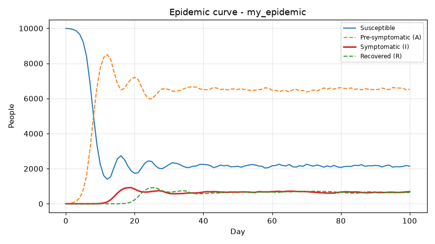
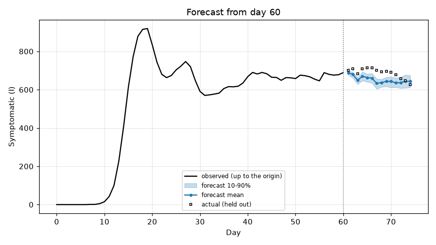
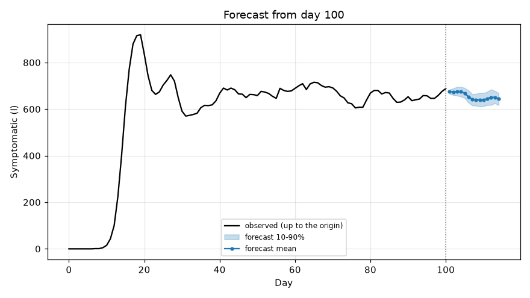
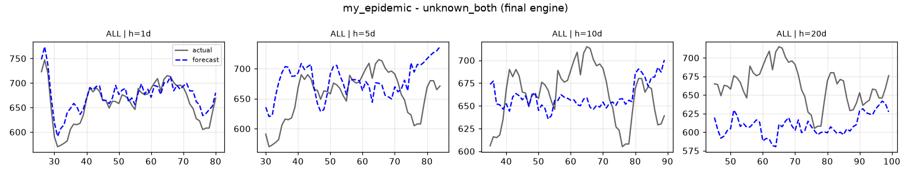
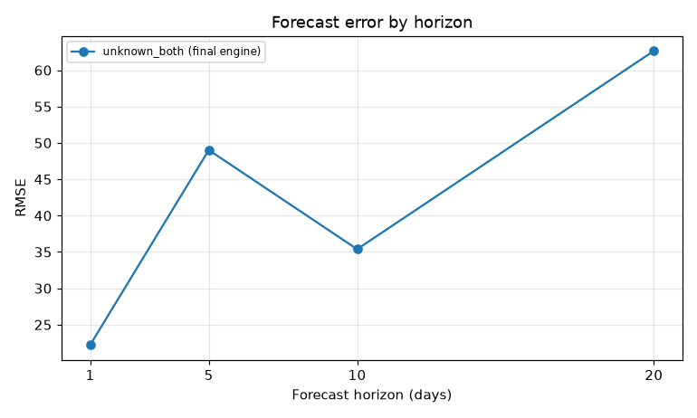
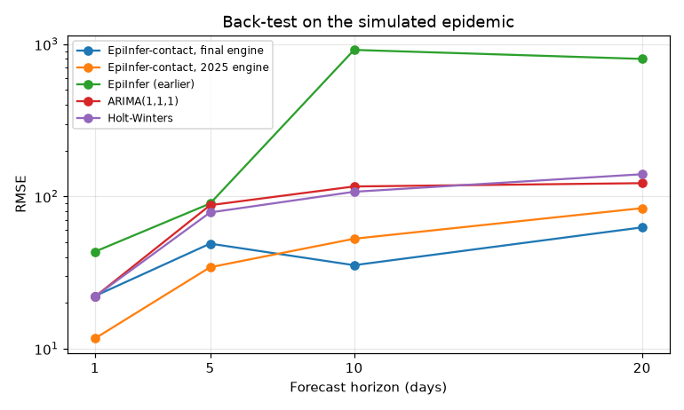

# Tutorial: forecast an epidemic with EpiInfer in Docker

This tutorial takes you from nothing to a forecast, a back-test of how good that forecast is,
and a comparison with the paper's other methods. Everything runs inside the Docker image, so
you need nothing installed except Docker.

**You will:**

1. simulate an epidemic in 10,000 people, so that the true outcome is known;
2. look at the data;
3. forecast 14 days ahead from day 60, then check the forecast against what happened;
4. make a genuine forecast past the end of the data;
5. back-test: forecast from every day from 25 to 79 and measure the error;
6. compare EpiInfer-contact (both engines) with the earlier EpiInfer, ARIMA and Holt-Winters;
7. convert your own case and contact lists, and forecast with them.

**Time:** about 10 minutes. Step 6's 2025-engine back-test is about 7 of them.

**Same numbers as here.** Steps 1–6 are
[`docs/tutorial/run_tutorial.sh`](tutorial/run_tutorial.sh), and every table and plot in them
is that script's output (the files are in [`docs/tutorial/outputs`](tutorial/outputs) and
[`docs/tutorial/img`](tutorial/img)). CI runs the script inside the Docker image on every
change and fails if any number differs, so you should get exactly these results. All the
randomness is seeded.

---

## 0. Set up

### Install Docker

- **macOS or Windows:** install [Docker Desktop](https://docs.docker.com/get-docker/) and
  start it.
- **Linux:** install [Docker Engine](https://docs.docker.com/engine/install/).

Check it works:

```bash
docker --version
```

### Get the image

Pull the released image (it works on Intel/AMD and ARM, including Apple silicon):

```bash
docker pull ghcr.io/nuzla/epiinfer:0.2.0
```

Or build it from a checkout of this repository:

```bash
git clone https://github.com/nuzla/epiinfer.git
cd epiinfer
docker build -f docker/Dockerfile -t ghcr.io/nuzla/epiinfer:0.2.0 .
```

### Make a working folder and a shortcut

```bash
mkdir -p epiinfer-tutorial/data epiinfer-tutorial/results
cd epiinfer-tutorial
```

The shell function `epi` runs one `epiinfer` command in a fresh container:

```bash
epi() { docker run --rm --user "$(id -u):$(id -g)" \
          -v "$PWD/data:/data" -v "$PWD/results:/work/results" \
          ghcr.io/nuzla/epiinfer:0.2.0 "$@"; }
```

How the pieces fit together:

| On your computer | Inside the container | What goes there |
|---|---|---|
| `./data` | `/data` | datasets |
| `./results` | `/work/results` (the working directory) | everything the commands write |

- **Paths.** Arguments are container paths: datasets are `/data/...` and outputs are
  `results/...`.
- **`--user "$(id -u):$(id -g)"`** makes the files the container writes belong to you.
- **Windows.** Run the commands in WSL or Git Bash.

Check the shortcut:

```bash
epi --version
```

```text
epiinfer 0.2.0
```

---

## 1. Simulate an epidemic

To judge a forecast you need to know what really happened. So we first simulate an epidemic
with the paper's agent-based model, AgeMixABM:

```bash
epi simulate --out /data/my_epidemic --contact age_structured --days 100 --seed 123
```

This takes a few seconds and writes `data/my_epidemic/`.

**The simulated population:**

- **People.** 10,000, in three age groups: 2,455 aged 0–19, 5,422 aged 20–60 and 2,123
  aged 61+.
- **Contacts.** Each day people meet according to an age-structured contact matrix. 70% of
  first-day contacts recur every day; the rest are re-drawn daily. Symptomatic people make
  no contacts (they isolate).
- **Disease.** A contact with a pre-symptomatic person (**A**) infects with probability
  **p1**. After 7 days in A, a person becomes symptomatic (**I**) with probability **p2**;
  otherwise they return to susceptible (**S**). Symptomatic people recover (**R**) after 7
  days and become susceptible again 7 days later.
- **True rates.** They differ by age group:

  | Age group | p1 | p2 |
  |---|---|---|
  | 0–19 | 0.25 | 0.15 |
  | 20–60 | 0.15 | 0.10 |
  | 61+ | 0.08 | 0.05 |

**The folder** holds the files described in [DATA_FORMAT.md](DATA_FORMAT.md):

| File | Content |
|---|---|
| `individual_day_state.csv` | every person's state (0 = S, 1 = A, 2 = I, 3 = R) on every day |
| `timed_edges.csv` | every contact: day, person i, person j |
| `states_total.csv` | daily totals of S, A, I, R |
| `age_group_population.csv` | group sizes |
| `daily_group_infected.csv`, `daily_group_avg_contacts.csv` | daily counts per age group |

The forecast target throughout is **the number of symptomatic people**, I.

## 2. Look at the data

```bash
epi describe --data /data/my_epidemic --plot results/01_epidemic_curve.png
```

```text
dataset            my_epidemic
people             10000
days               0-100
peak symptomatic   919 on day 19
contacts per day   34187 (days 1-100)
pre-symptomatic A  recorded
usable engines     final, contact, compartmental
results/01_epidemic_curve.png
```



- **The shape.** The epidemic peaks at 919 symptomatic people on day 19. Because immunity
  lasts only 7 days, it then settles at about 650–700 symptomatic people a day.
- **Why A is so large.** Most people are in A at any moment, because only 5–15% of
  infections ever become symptomatic.
- **Usable engines.** This line lists which of the library's three methods can run on the
  folder:
  - **`final`**: the October 2026 EpiInfer-contact. It needs only who is symptomatic or
    recovered, plus the contacts.
  - **`contact`**: the 2025 EpiInfer-contact. It also needs who is in A, which only
    simulations record.
  - **`compartmental`**: the earlier EpiInfer. It needs only daily counts per age group.

## 3. Forecast from day 60

Pretend it is day 60: forecast the next 14 days, using nothing after day 60. Because the
data continue to day 100, we can then see how close the forecast came.

```bash
epi forecast --data /data/my_epidemic --from-day 60 --horizon 14 \
  --out results/02_forecast_day60.csv --plot results/02_forecast_day60.png
```

**What the default (`final`) engine does:**

1. **Calibrate.** It searches a grid of p1 and p2 values (0.05–0.30) for the pair whose
   7-day forecasts best matched the last 14 days. This is method `unknown_both`, the
   default: neither rate is given. It uses one (p1, p2) for everyone.
2. **Rebuild the pre-symptomatic people.** It infers them from who became symptomatic: each
   symptomatic person stands for 1/p2 exposures, and the unseen ones are drawn from the
   people who had contacts. **It never reads state A**, which real data would not have.
3. **Simulate.** It runs 30 simulated futures on the day-60 contact network and reports
   their mean and 10th–90th percentiles.

`results/02_forecast_day60.csv`:

```text
group,origin_day,target_day,horizon,mean,p10,p90,actual,p1_used,p2_used
ALL,60,61,1,688.7,678.0,699.0,700.0,0.125,0.1
ALL,60,62,2,679.6,661.6,691.5,709.0,0.125,0.1
ALL,60,63,3,648.9,628.8,662.0,684.0,0.125,0.1
ALL,60,64,4,670.2,647.7,693.2,708.0,0.125,0.1
ALL,60,65,5,663.6333333333333,641.0,682.3,715.0,0.125,0.1
ALL,60,66,6,660.0666666666667,635.0,684.9,713.0,0.125,0.1
ALL,60,67,7,632.9333333333333,603.8,656.2,701.0,0.125,0.1
ALL,60,68,8,637.0333333333333,614.8,654.5,694.0,0.125,0.1
ALL,60,69,9,643.3333333333334,617.4,665.0,696.0,0.125,0.1
ALL,60,70,10,643.2666666666667,611.2,667.3,691.0,0.125,0.1
ALL,60,71,11,635.6,612.8,661.0,677.0,0.125,0.1
ALL,60,72,12,636.7666666666667,607.7,666.0,657.0,0.125,0.1
ALL,60,73,13,643.2333333333333,609.4,677.3,648.0,0.125,0.1
ALL,60,74,14,644.2,612.0,674.4,627.0,0.125,0.1
```

| Column | Meaning |
|---|---|
| `origin_day` | the last day the forecast could see |
| `target_day`, `horizon` | the day forecast, and how many days ahead it is |
| `mean`, `p10`, `p90` | the forecast: the average of the 30 simulated futures, and their 10th and 90th percentiles |
| `actual` | what really happened (empty for days beyond the data) |
| `p1_used`, `p2_used` | the calibrated rates |



**Reading the result:**

- **The rates.** Calibration chose p1 = 0.125 and p2 = 0.10, close to the adults' true
  values (0.15, 0.10). Adults are more than half the population.
- **The forecast.** It follows the level of the epidemic but runs 5–10% low on days 64–71.
  The true count is inside the 10–90% band only on days 72–74. The band is narrow because
  the thirty simulations capture the randomness of the epidemic, not the uncertainty in the
  calibrated rates.

## 4. Forecast past the end of the data

Leave out `--from-day` and the forecast starts from the last observed day, 100:

```bash
epi forecast --data /data/my_epidemic --horizon 14 \
  --out results/03_forecast_future.csv --plot results/03_forecast_future.png
```

```text
group,origin_day,target_day,horizon,mean,p10,p90,actual,p1_used,p2_used
ALL,100,101,1,675.0,664.9,683.1,,0.125,0.1
ALL,100,102,2,673.0666666666667,659.9,689.0,,0.125,0.1
...
ALL,100,114,14,644.3333333333334,616.8,668.5,,0.125,0.1
```



This is what you would do with live data. `actual` is empty because those days have not
happened. Contacts after day 100 are unknown, so day 100's network is reused for every
future day.

## 5. Back-test: how good are the forecasts?

One forecast tells you little. A **back-test** forecasts from every day in turn, here every
day from 25 to 79, using only the data up to that day. It then scores the forecasts made 1, 5,
10 and 20 days ahead against the truth.

```bash
epi run --data /data/my_epidemic --method unknown_both \
  --out results/04_backtest_final --plots
```

```text
    dataset       method group  horizon  n      rmse    frmse  frmse_rel
my_epidemic unknown_both   ALL        1 55 22.196007 0.033632   0.035648
my_epidemic unknown_both   ALL        5 55 49.020250 0.074571   0.078426
my_epidemic unknown_both   ALL       10 55 35.380628 0.053350   0.053851
my_epidemic unknown_both   ALL       20 55 62.659970 0.094455   0.091550
results/04_backtest_final/forecast_my_epidemic_unknown_both.png
results/04_backtest_final/rmse_my_epidemic_unknown_both.png
```

| Column | Meaning |
|---|---|
| `n` | number of forecasts scored (55 origins, days 25–79) |
| `rmse` | root mean squared error, in people |
| `frmse` | RMSE divided by the mean actual count (the paper's 2025 "fractional RMSE") |
| `frmse_rel` | root mean squared *relative* error (the October 2026 paper's fRMSE) |

A 1-day forecast is off by about 22 people out of roughly 660, or 3–4%. Twenty days ahead
the error is about 63 people, or 9%.



Each panel plots, for one horizon, every forecast (blue, dashed) against what happened (grey)
on the day it was aimed at.



**Files in `results/04_backtest_final/`:**

| File | Content |
|---|---|
| `predictions_my_epidemic_unknown_both.csv` | every forecast: origin, target day, predicted, actual, rates used |
| `rates_my_epidemic_unknown_both.csv` | the (p1, p2) in use at each origin |
| `summary_my_epidemic_unknown_both.csv` | the table above |

The rates are recalibrated every 5 days and damped (a new estimate replaces the old one only
as far as it fits better). They start at (0.15, 0.10). They drift to (0.10, 0.12) by day 75
as the epidemic settles.

## 6. Compare with the paper's other methods

The paper compares EpiInfer-contact with the earlier EpiInfer, ARIMA, Holt-Winters and an
LSTM. The library has all but the LSTM. All of the following use the same forecast origins
(25–79).

### 6a. EpiInfer-contact, 2025 engine

```bash
epi run --data /data/my_epidemic --engine contact --method unknown_both \
  --horizons 1 5 10 20 --last-origin 79 --out results/05_backtest_contact
```

This is the code behind most of the paper's tables. It calibrates a separate (p1, p2) for
each age group every day, and forecasts each group. It is seeded with **the true list of
pre-symptomatic people from the simulator**, an advantage real data cannot give. It prints a
row per age group plus the total; the totals are:

```text
    dataset       method group  horizon  n      rmse    frmse  frmse_rel
my_epidemic unknown_both   ALL        1 55 11.684699 0.017705   0.018046
my_epidemic unknown_both   ALL        5 55 34.310136 0.052194   0.055401
my_epidemic unknown_both   ALL       10 55 52.779822 0.079586   0.083180
my_epidemic unknown_both   ALL       20 55 83.813474 0.126343   0.123363
```

This back-test takes about 7 minutes.

### 6b. The earlier EpiInfer

```bash
epi run --data /data/my_epidemic --engine compartmental --method unknown_both \
  --out results/06_backtest_compartmental
```

```text
    dataset       method group  horizon  n       rmse    frmse  frmse_rel
my_epidemic unknown_both   ALL        1 55  43.414112 0.065783   0.066390
my_epidemic unknown_both   ALL        5 55  89.916927 0.136784   0.147207
my_epidemic unknown_both   ALL       10 55 917.458551 1.383419   1.407327
my_epidemic unknown_both   ALL       20 55 800.591472 1.206834   1.213571
```

This is the authors' previous model. It is a deterministic compartmental model that uses
only daily counts per age group, with no contact list, and it takes under a second.

With both rates unknown it fits p1 and p2 to the last five days only. On this epidemic the
fit puts p2 at the top of the grid (0.30, three times the true adult value) at 75% of the
origins, so forecasts 10–20 days ahead overshoot badly. The paper's own tables show the same
pattern for this model.

### 6c. Statistical baselines

```bash
epi baseline --data /data/my_epidemic --which arima --last-origin 79 --out results/07_arima.csv
epi baseline --data /data/my_epidemic --which holt_winters --last-origin 79 \
  --out results/07_holt_winters.csv
```

```text
method  horizon  n       rmse    frmse
 arima        1 55  21.966988 0.033285
 arima        5 55  87.692891 0.133401
 arima       10 55 116.345709 0.175436
 arima       20 55 122.322350 0.184392

      method  horizon  n       rmse    frmse
holt_winters        1 55  21.996859 0.033330
holt_winters        5 55  78.547691 0.119489
holt_winters       10 55 107.386200 0.161926
holt_winters       20 55 140.000378 0.211040
```

Both use only the daily count of symptomatic people:

- **ARIMA(1,1,1)** is refitted on the whole history at each origin.
- **Holt-Winters** (additive damped trend) is refitted on the last 14 days.

### 6d. Everything on one chart

```bash
epi plot-rmse \
  "EpiInfer-contact, final engine=results/04_backtest_final/summary_my_epidemic_unknown_both.csv" \
  "EpiInfer-contact, 2025 engine=results/05_backtest_contact/summary_my_epidemic_unknown_both.csv" \
  "EpiInfer (earlier)=results/06_backtest_compartmental/summary_my_epidemic_unknown_both.csv" \
  "ARIMA(1,1,1)=results/07_arima.csv" \
  "Holt-Winters=results/07_holt_winters.csv" \
  --out results/08_rmse_comparison.png --title "Back-test on the simulated epidemic" --log-y
```



| RMSE (people) | 1 day | 5 days | 10 days | 20 days |
|---|---|---|---|---|
| EpiInfer-contact, final engine | 22.2 | 49.0 | **35.4** | **62.7** |
| EpiInfer-contact, 2025 engine (uses the true A) | **11.7** | **34.3** | 52.8 | 83.8 |
| EpiInfer, earlier model | 43.4 | 89.9 | 917.5 | 800.6 |
| ARIMA(1,1,1) | 22.0 | 87.7 | 116.3 | 122.3 |
| Holt-Winters | 22.0 | 78.5 | 107.4 | 140.0 |

**What this shows, for this one epidemic and seed:**

- **Up to 5 days, the 2025 engine is best**, helped by knowing who is pre-symptomatic.
- **At 10 and 20 days the final engine is best**, without that information.
- **From day 5 on, both EpiInfer-contact engines beat ARIMA and Holt-Winters.** At day 1 the
  final engine and the baselines tie (22 people): a day ahead, "tomorrow ≈ today" is hard
  to beat.
- **The earlier EpiInfer**, with both rates unknown, is the least accurate.
- **Noise.** One simulated epidemic gives one sample. Differences of a few people are within
  Monte-Carlo noise: add `--seed 1`, `--seed 2` … to the `run` commands to see how much
  results vary.

---

## 7. Your own data

### The files

The default engine needs only two things for each day:

- **who is symptomatic or recovered**, in `individual_day_state.csv`;
- **who met whom**, in `timed_edges.csv`.

```text
data/my_data/
  individual_day_state.csv     id,day,state      (2 = symptomatic, 3 = recovered, else 0)
  timed_edges.csv              day,i,j
  age_group_population.csv     age_group,population     (gives the population size)
```

People are numbered 0 … N−1 and days 0, 1, 2 … The full specification is in
[DATA_FORMAT.md](DATA_FORMAT.md).

### Convert a case list and a contact list

Most contact-tracing systems keep a list of cases (who, and the date symptoms began) and a
list of contacts (date, person, person):

```text
cases.csv                 contacts.csv
person,onset              date,a,b
P1,2026-05-12             2026-03-02,P6230,P8047
P2,2026-03-24             2026-03-02,P4062,P8490
...                       ...
```

`epiinfer from-cases` turns them into a dataset folder. Each case is symptomatic for
`--duration` days from onset and recovered (immune) for `--rec-duration` days after that:

```bash
cp /path/to/cases.csv /path/to/contacts.csv data/
epi from-cases --cases /data/cases.csv --contacts /data/contacts.csv --out /data/my_data \
  --duration 7 --rec-duration 7
```

```text
wrote /data/my_data: 9981 people, days 0-99 (day 0 = 2026-03-02)
```

Person labels can be any text; `people.csv` in the output maps the numeric ids back to
them. In Python the same is `epiinfer.convert.cases_to_dataset`, and
[`examples/convert_case_list.py`](../examples/convert_case_list.py) is a script version.

The output above comes from the tutorial epidemic written out as a case list and a contact
list. Starting from just those two files, `describe` sees the same epidemic, now without
state A:

```text
dataset            my_data
people             9981
days               0-99
peak symptomatic   919 on day 18
contacts per day   34187 (days 0-99)
pre-symptomatic A  not recorded
usable engines     final
```

(The 19 people who never had a contact or symptoms are not in the files, and day 0 is now
the first contact day, so day numbers are one lower than in the simulation.)

### Forecast

```bash
epi describe --data /data/my_data
epi forecast --data /data/my_data --horizon 14 --duration 7 --rec-duration 7 \
  --out results/my_forecast.csv --plot results/my_forecast.png
epi run --data /data/my_data --method unknown_both --duration 7 --rec-duration 7 \
  --out results/my_backtest --plots
```

### Settings that matter

| Option | Meaning | Default |
|---|---|---|
| `--inc` | days infected before symptoms | 7 |
| `--duration` | days symptomatic | 7 |
| `--rec-duration` | days immune after recovery before reinfection is possible (final engine) | 7 |
| `--method` | which rates you know: `unknown_both`, `known_p1`, `known_p2`, `known_both` (with `--p1-true` / `--p2-true`) | `unknown_both` |
| `--engine` | `final`, `contact` (needs state A) or `compartmental` (needs the per-group count files) | `final` |
| `--seed`, `--num-sims` | random seed; simulated futures per forecast | 0; 30 |
| `--start-eval`, `--last-origin`, `--horizons` | back-test origins and horizons | 25; 79; 1 5 10 20 |

Set `--inc`, `--duration` and `--rec-duration` to what is known about your disease. The
model does not estimate them.

**Aggregate data only?** If you have daily counts per age group but no individual records or
contacts, use `--engine compartmental`. It needs `states_total.csv`,
`age_group_population.csv`, `daily_group_infected.csv` and `daily_group_avg_contacts.csv`.

---

## 8. Reproducing the paper's tables

With the paper's datasets in `./data` (see [REPRODUCING.md](REPRODUCING.md) for where they
come from and what each table needs):

```bash
epi reproduce --table epiinfer_age_structured --data /data/age_structured --out results/paper
epi reproduce --table appendix --scale 0.2 --data /data/appendix_april0.2 --jobs 4 --out results/paper
epi reproduce --table openabm --data /data/openabm --out results/paper
```

The first takes under a second and reproduces the earlier EpiInfer's row of Tables 2–5 and
14 exactly:

```text
                    table     method  horizon contacts  paper_rmse    rmse  rmse_ratio  paper_frmse  frmse  n_origins
Tables 2-5, 14 (EpiInfer) known_both        1 same_day     180.172 180.172       1.000        0.262  0.262         61
Tables 2-5, 14 (EpiInfer) known_both        5 same_day     408.346 408.346       1.000        0.597  0.597         61
Tables 2-5, 14 (EpiInfer) known_both       10 same_day     161.629 161.629       1.000        0.243  0.243         61
Tables 2-5, 14 (EpiInfer) known_both       20 same_day      95.961  95.961       1.000        0.143  0.143         61
```

What reproduces and what does not, and why, is in [PAPER_VS_CODE.md](PAPER_VS_CODE.md).

---

## Apptainer / Singularity

On a cluster without Docker, convert the image once and replace `epi` with:

```bash
apptainer pull epiinfer.sif docker://ghcr.io/nuzla/epiinfer:0.2.0
epi() { apptainer run --bind "$PWD/data:/data" epiinfer.sif "$@"; }
```

Run from the folder that holds `data/` and `results/`. Apptainer runs as you, so there is no
`--user`. This route has not been tested by the maintainers.

## Troubleshooting

- **`Unable to find image`.** Run the `docker pull` (or `docker build`) in step 0 first.
- **`Permission denied` writing `results/`.** Create `results/` before the first run and
  keep the `--user "$(id -u):$(id -g)"` part of `epi`.
- **`dataset folder not found`.** Give the container path (`/data/...`), not the path on
  your computer.
- **`from_day must be between ...`.** Calibration needs at least 22 observed days (both
  rates unknown) before the forecast origin.
- **Numbers differ from this page.** Check `epi --version` says 0.2.0 and that you kept
  `--seed 123` for `simulate`. CI compares every number on this page with the image on
  every change.
- **Slow.** The 2025 engine's back-test is the slow step (minutes). Give Docker Desktop
  more CPUs, or add `--workers 4` to run its simulations in threads (results are
  identical).
